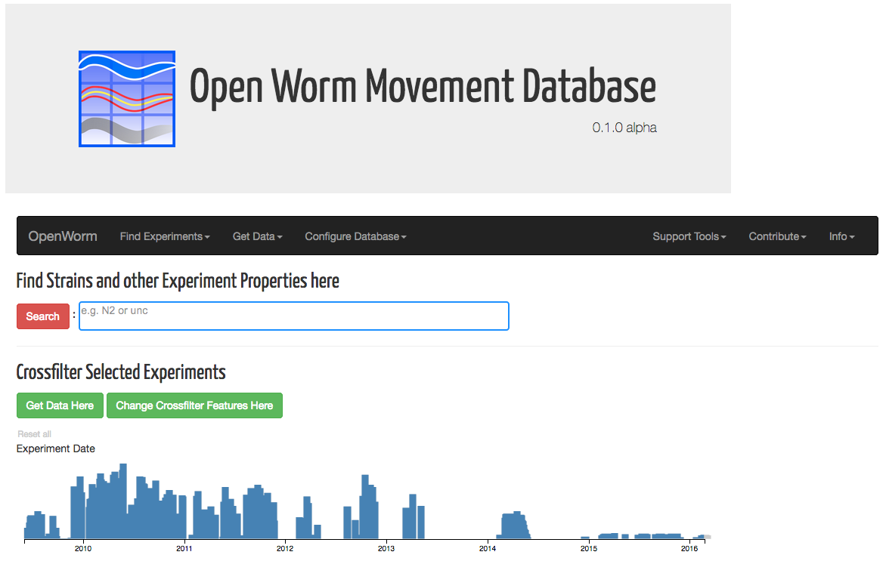

# Worm Movement Database

Movement Analysis on the cloud.

This is an open database framework for users to search for and download
*C. elegans* movement experiment data, as well as features means metadata.

If you have found a bug, please raise an issue with the github
repo. For general feedback and suggestions, please use our [feedback
form](https://goo.gl/forms/4ryQpnlkJRhAv7vx1).

## Overview and General Workflow



* Overview of workflow:
  1. The full database is loaded at the start.
  2. Use the **Search Bar** to load specific subsets of experiments.
  3. Dynamically **refine** the set of experiments by crossfiltering on ranges of features means values.
  4. **Download** experiment data and/or features means data for experiments found.

Details of the process of running through the **full workflow** can be found here - [Movement Database Workflow](webworm_docs/Workflow.md)

## Overview of entire OpenWorm project

(Red represents this repository; "You are Here!")


## Tutorial

Please try our basic **tutorial** here - [Movement Database Tutorial](webworm_docs/Tutorial-0.md)

## Interface Features Reference Documentation

Information on how each interface component feature can be used is
found here - [Movement Database Features Documentation](webworm_docs/Features.md)

## Contributing

### Preparation

Create virtual environment

```shell
python -m venv venv
```

Activate virtual environment.

On Windows
```shell
venv/Scripts/activate
```

On Linux
```shell
source venv/Scripts/activate
```

### Local setup

Create `movement_site/local_settings.py` with approximately following content

```py
import os
LOCAL_BASE_DIR = os.path.dirname(os.path.dirname(os.path.abspath(__file__)))

# SQLite database engine for much simpler setup
# For production, consider using PostgreSQL or another robust database engine
DATABASES = {
    'default': {
        'ENGINE': 'django.db.backends.sqlite3',
        'NAME': LOCAL_BASE_DIR / 'db.sqlite3',
    }
}

ALLOWED_HOSTS = ['127.0.0.1']

EMAIL_USE_TLS = True
EMAIL_HOST = 'smtp.gmail.com'
EMAIL_HOST_USER = 'test@gmail.com'
EMAIL_HOST_PASSWORD = 'test'
EMAIL_PORT = 587
```

You may need run following commmand to apply migrations for a first time, and in case you actively develop things.
```shell
python manage.py migrate
```

### Develoment workflow

Run development server
```shell
python manage.py runserver
```

Open http://127.0.0.1:8000/ in the browser